<p align="center">
  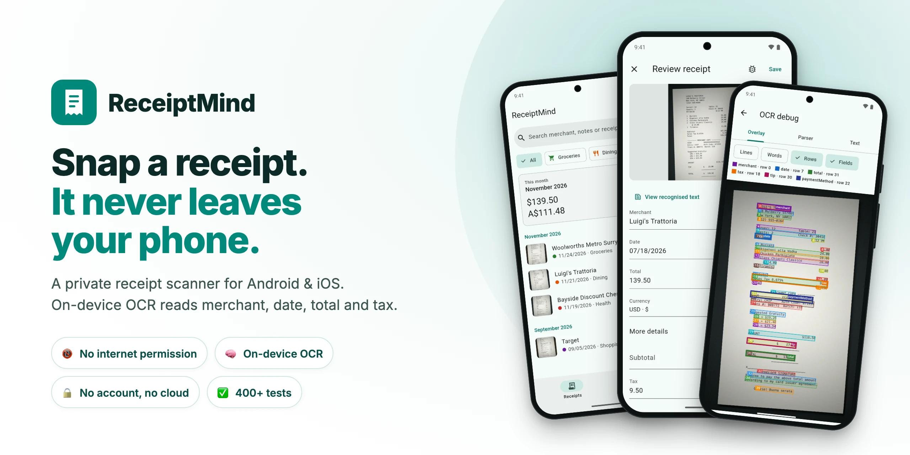
</p>

<h1 align="center">ReceiptMind: Private Offline AI Receipt Scanner</h1>

<p align="center">
  <a href="LICENSE"></a>
  <a href="https://flutter.dev"></a>
  <a href="#build-from-source"></a>
  <a href="#privacy-you-can-verify"></a>
  <a href="#from-pixels-to-fields"></a>
  <a href="#engineering-highlights"></a>
</p>

<p align="center">
  <b>Snap a receipt and the phone reads it.</b> Merchant, date, total, tax, tip and payment method are extracted
  <b>on the device</b> and saved to a private expense tracker.<br>
  No account, no cloud, no ads, no tracking. Your receipts never leave your phone.
</p>

<p align="center">
  <a href="#demo">Demo</a> ·
  <a href="#features">Features</a> ·
  <a href="#from-pixels-to-fields">How it works</a> ·
  <a href="#privacy-you-can-verify">Privacy</a> ·
  <a href="#architecture">Architecture</a> ·
  <a href="#roadmap">Roadmap</a> ·
  <a href="#build-from-source">Build</a>
</p>

> **Status: v0.1 in active development.** Scanning, on-device OCR, parsing, review, the receipt list, categories,
> settings and CSV export work today. Every screenshot below is from the current Android build. Hardening and the
> first signed APK release are next ([roadmap](#roadmap)).

## Demo

<table>
  <tr>
    <td width="44%" align="center">
      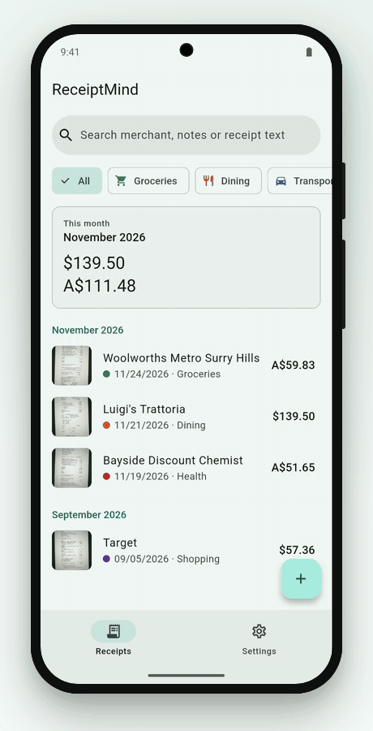
    </td>
    <td>
      <h3>Recorded in airplane mode</h3>
      <ol>
        <li><b>Import</b> a photo (or scan with the camera) and crop it.</li>
        <li><b>Read on the phone</b>: <i>"This happens on your phone. Nothing is uploaded."</i></li>
        <li><b>Review</b> the pre-filled fields: merchant, date, total, tax, currency.</li>
        <li><b>Pick a category and save.</b> The receipt lands in its month with a thumbnail.</li>
      </ol>
      <p>The receipt in the demo is a German restaurant bill (<code>€50,40</code>, <code>Datum: 21.03.26</code>,
      MwSt table): the parser handles comma decimals, day-first dates and VAT tables, not only US receipts.</p>
    </td>
  </tr>
</table>

## Screenshots

<p align="center">
  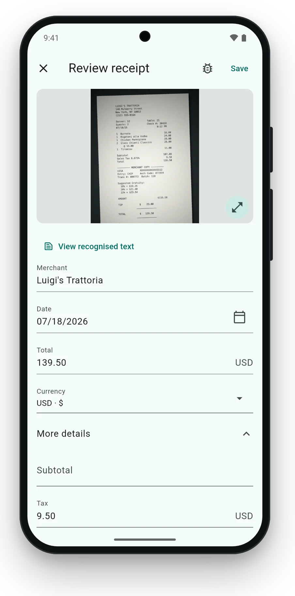
  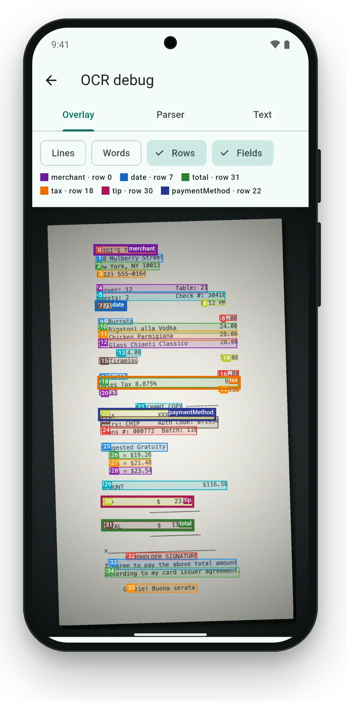
  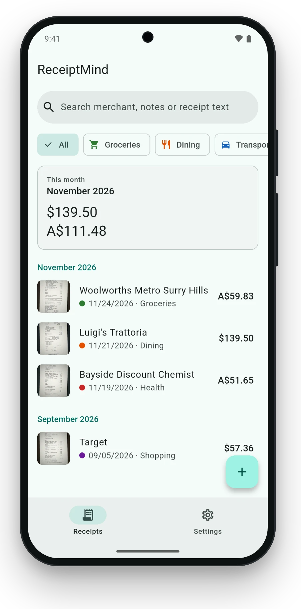
  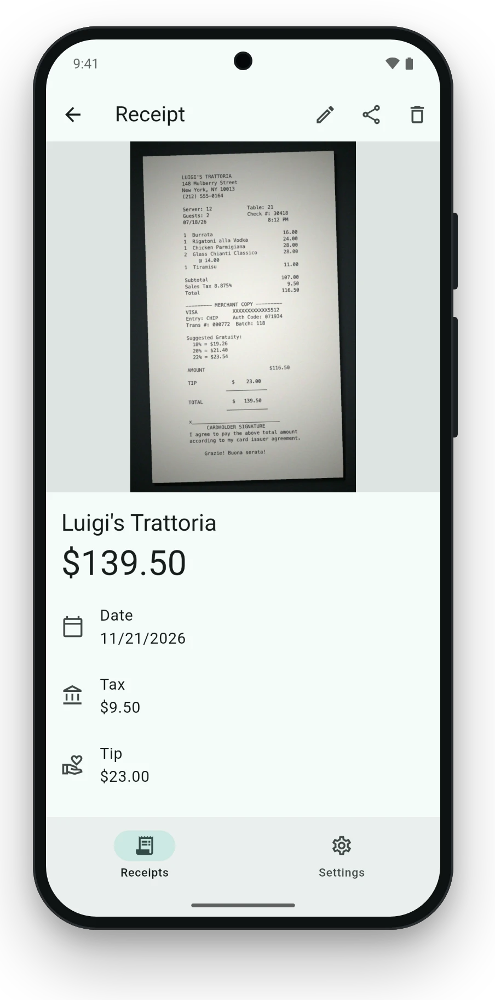
</p>
<p align="center">
  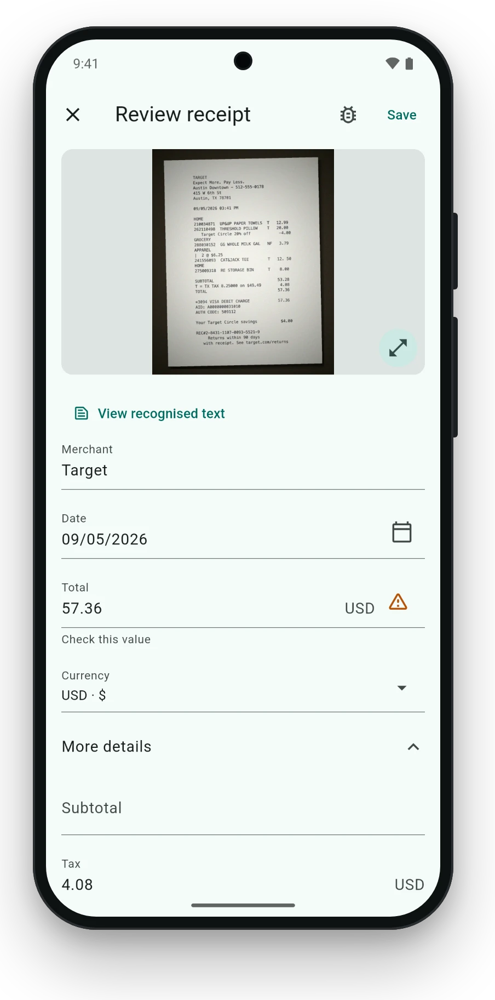
  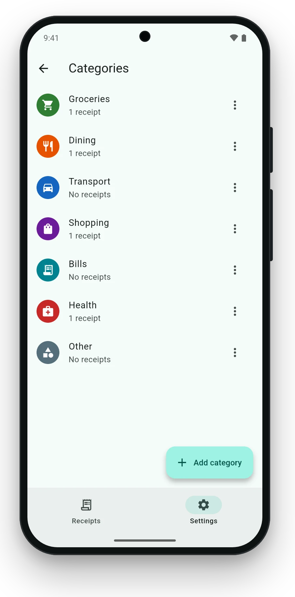
  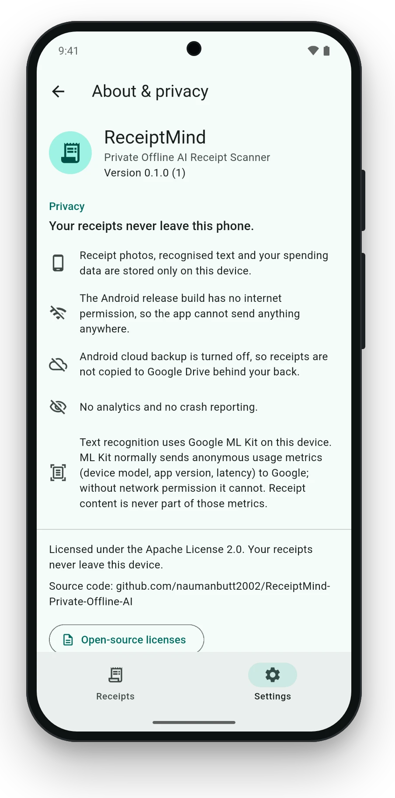
  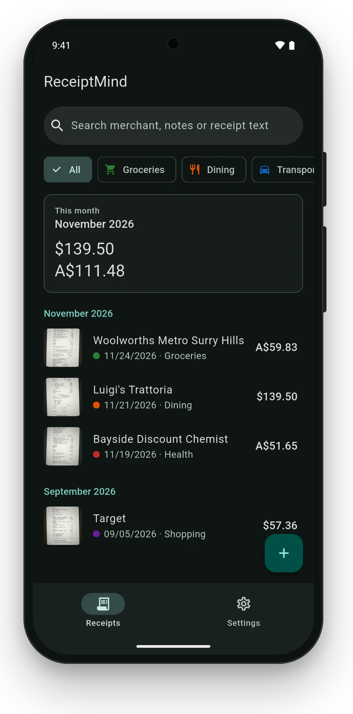
</p>

## Why ReceiptMind

<table>
  <tr>
    <td width="33%" valign="top">
      <h3>📵 Provably offline</h3>
      The release APK has <b>no <code>INTERNET</code> permission</b> and cloud backup is off. It can't upload
      anything, and you can check that yourself in one command.
    </td>
    <td width="33%" valign="top">
      <h3>🧠 Reads receipts on-device</h3>
      Google ML Kit text recognition runs on the phone, then a tested rule parser rebuilds the printed rows and
      scores every field with a confidence.
    </td>
    <td width="33%" valign="top">
      <h3>✋ You stay in control</h3>
      Nothing is saved without your review. Unsure fields are flagged ⚠️, and you can zoom into the photo or read
      the recognised text before saving.
    </td>
  </tr>
</table>

## Features

- **Scan or import**: camera scanning with automatic edge detection, or pick a photo from the gallery and crop it.
- **On-device OCR**: Google ML Kit text recognition runs entirely on the phone (Latin script).
- **Smart pre-fill**: a rule-based parser reads merchant, date, total, subtotal, tax (incl. VAT/MwSt tables),
  tip, currency and payment method, with a confidence score per field. Unsure fields are flagged ⚠️.
- **You stay in control**: every receipt is reviewed before saving; zoom into the photo, see the recognised text,
  fix anything. Manual entry works too.
- **Expense tracker**: search (merchant, notes and receipt text), category filters, month sections and
  monthly totals per currency, swipe to delete with undo.
- **Categories**: 7 defaults (Groceries, Dining, Transport, …); add your own with icons and colours.
- **Multi-currency and locale aware**: every receipt keeps its own ISO currency; amounts are exact integer minor
  units (never floating point); default currency and date format follow your region.
- **CSV export**: all receipts or a date range, Excel-friendly (UTF-8 BOM) with CSV-injection protection.
- **Light and dark theme**, large-text and screen-reader friendly.
- **Developer mode**: an OCR debug view (boxes, rows, parser trace) and *Export as fixture* so anyone can
  contribute hard receipts to improve the parser.

## From pixels to fields

<p align="center">
  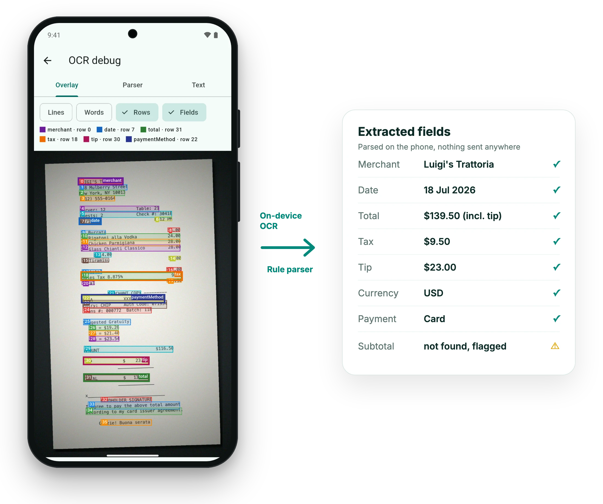
</p>

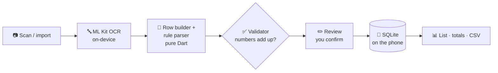

1. The document scanner returns a cropped photo of the receipt.
2. ML Kit returns text lines with bounding boxes. OCR engines often return item names and prices as separate
   columns, so the parser **rebuilds the printed rows from the boxes** (the numbered rows in the image above).
3. The parser scores candidates for each field (keywords, position, text size, consistency such as
   *total = subtotal + tax + tip*), and a validator checks that the numbers add up.
4. You review and save. The photo is stored compressed (≤ 2400 px, no EXIF) with a thumbnail.

In developer mode, the **Parser** tab shows the full trace for every receipt: OCR engine, image size, rows,
and each field's value, confidence and the rule that found it.

<details>
<summary><b>Parser accuracy</b> (28 fixture receipts from 4 countries)</summary>

Measured with `dart run tool/parser_report.dart` on the fixture set (28 receipts from Australia, the US,
the UK and Germany, including 8 scored blind as a holdout):

| Country | merchant | date | total | subtotal | tax | tip | currency | payment |
|---|---:|---:|---:|---:|---:|---:|---:|---:|
| AU | 100 % | 100 % | 100 % | 100 % | 100 % | 100 % | 100 % | 100 % |
| DE | 100 % | 100 % | 100 % | — | 100 % | — | 100 % | 100 % |
| UK | 100 % | 100 % | 100 % | 100 % | 100 % | — | 100 % | 100 % |
| US | 100 % | 100 % | 100 % | 100 % | 100 % | 100 % | 100 % | 100 % |

The fixtures are synthetic but realistic (supermarkets, restaurants with tips, fuel, pharmacies, retail),
so real-world accuracy will be lower. That's exactly why contributing real, anonymised receipts helps
([how](CONTRIBUTING.md#adding-receipt-fixtures)).

</details>

## Privacy you can verify

<table>
  <tr>
    <td width="30%" align="center"></td>
    <td valign="top">

- Receipt photos, recognised text and your spending data are stored **only on your device**.
- The Android release build has **no `INTERNET` permission**, so the app cannot send anything anywhere.
- Android cloud backup is turned off, so receipts are not copied to Google Drive behind your back.
  An explicit, encrypted backup you control is planned for v0.3.
- No analytics and no crash reporting.
- Photos are re-encoded before saving, which strips EXIF metadata such as GPS location.
- Text recognition uses Google ML Kit **on-device**. ML Kit normally sends anonymous usage metrics
  (device model, app version, latency) to Google; without network permission it cannot. Receipt
  content is never part of those metrics. A fully open-source build using Tesseract is planned.

Check it yourself on any release build:

```bash
flutter build apk --release
aapt2 dump permissions build/app/outputs/flutter-apk/app-release.apk | grep INTERNET
# prints nothing: the permission isn't there
```

</td>
  </tr>
</table>

## Architecture

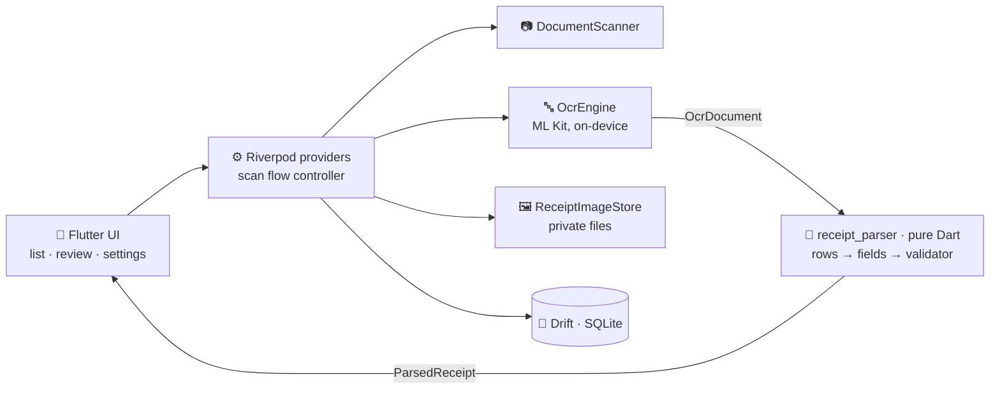

- Every platform plugin sits behind an interface (`DocumentScanner`, `OcrEngine`, `ReceiptImageStore`), so tests
  swap in fakes through Riverpod provider overrides.
- The parser package has **no Flutter or plugin imports**. It defines its own `OcrDocument` input, so any OCR engine
  (ML Kit now, Tesseract later) can feed it, and it runs in plain `dart test`.
- v0.2 adds an on-device LLM parser **next to** the rule parser. Both return the same `ParsedReceipt` and go through
  the same validator, so the review screen doesn't change.

## Engineering highlights

| | |
|---|---|
| 💰 **Exact money** | Integer minor units plus an ISO 4217 code everywhere. Never `double`, so totals never drift by a cent. |
| 🧪 **Tested** | 400+ unit and widget tests (about 360 in the parser alone), an accuracy report with a blind holdout, and on-device integration tests for the OCR pipeline, image store and scan flow. |
| 🔒 **Offline by construction** | The release manifest removes `INTERNET`; release builds keep the ML Kit R8 rules so recognition still works after shrinking. |
| 🌍 **Locale aware** | Comma or dot decimals, day- or month-first dates, VAT/MwSt tables, per-receipt currency, region defaults. |
| 🧩 **Clean boundaries** | Pure-Dart parser package, plugins behind interfaces, generated code committed and checked for staleness. |
| ♿ **Accessible** | Large-text and screen-reader friendly, light and dark themes. |

## Tech stack

| | |
|---|---|
| App | Flutter 3.47 · Dart 3.13 · Material 3 |
| State and navigation | Riverpod 3 (code generation) · go_router |
| Storage | Drift (SQLite) · files in the private app-support directory |
| OCR and scanning | Google ML Kit Text Recognition (on-device) · `cunning_document_scanner` |
| Parser | [`packages/receipt_parser`](packages/receipt_parser): pure Dart, no Flutter imports, ~360 unit tests |
| Quality | `flutter_lints` + stricter rules · 400+ widget/unit tests · on-device integration tests |

<details>
<summary><b>Project structure</b></summary>

```
lib/
  app/                 router, theme, start-up housekeeping
  core/                money, dates, locale defaults, database (Drift), settings, shared widgets
  features/
    scan/              document scanner, ML Kit OCR engine, scan flow controller
    receipts/          repository + image store, list, detail, review screen
    categories/        category management
    settings/          settings, About & privacy
    export/            CSV export
    developer/         OCR debug view, fixture export
packages/receipt_parser/   rule-based parser, lexicons (en, de), fixtures, accuracy report
integration_test/          on-device tests (OCR pipeline, image store, scan flow)
```

</details>

## Roadmap

| Version | Scope | Status |
|---|---|---|
| **v0.1** | Scan / import, on-device OCR, rule parser, review screen, receipt list, search, categories, monthly totals, CSV export, dark mode, developer mode | 🚧 features done, hardening + first APK release next |
| v0.2 | **Optional on-device AI**: a small Gemma model running on the phone (`flutter_gemma`) as a second parser for messy receipts, plus line items, auto-categorisation, charts and budgets. The model download is opt-in; receipts are still processed on the device. | planned |
| v0.3 | App lock, encrypted backup, home-screen widget, batch import, share-to-app | planned |
| v1.0 | Warranty reminders, tax reports, tap a field to see where it was found on the photo | planned |

## Build from source

Requirements: Flutter 3.47+ (Dart 3.13+), Android SDK 36, and Xcode 16+ for iOS.

```bash
flutter pub get
flutter run
```

Run the checks:

```bash
flutter analyze
flutter test
(cd packages/receipt_parser && dart test && dart run tool/parser_report.dart --check)
```

Generated code (`*.g.dart`, localizations) is committed, so you only need `build_runner` when you change
annotated code. See [CONTRIBUTING.md](CONTRIBUTING.md).

## Contributing

Contributions are welcome. **Adding receipts from your country** is the easiest way to help, and it
needs no Flutter knowledge. Adding a language to the parser is just a keyword list. Start with
[CONTRIBUTING.md](CONTRIBUTING.md).

## About the author

Built by **Muhammad Nauman**, a Flutter and native mobile developer (Kotlin, Swift) who builds
privacy-first apps, on-device AI features and Firebase/Supabase back ends.

Need an app like this? [Hire me on Upwork](https://www.upwork.com/freelancers/~012b26392fc8dd6f0e) ·
[GitHub](https://github.com/naumanbutt2002)

## License

[Apache License 2.0](LICENSE) © 2026 Muhammad Nauman. See [NOTICE](NOTICE) for third-party terms.
