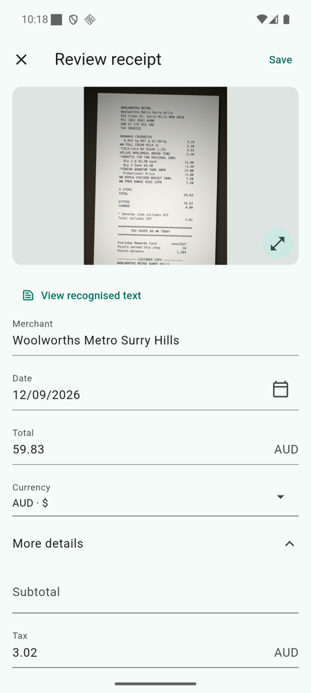
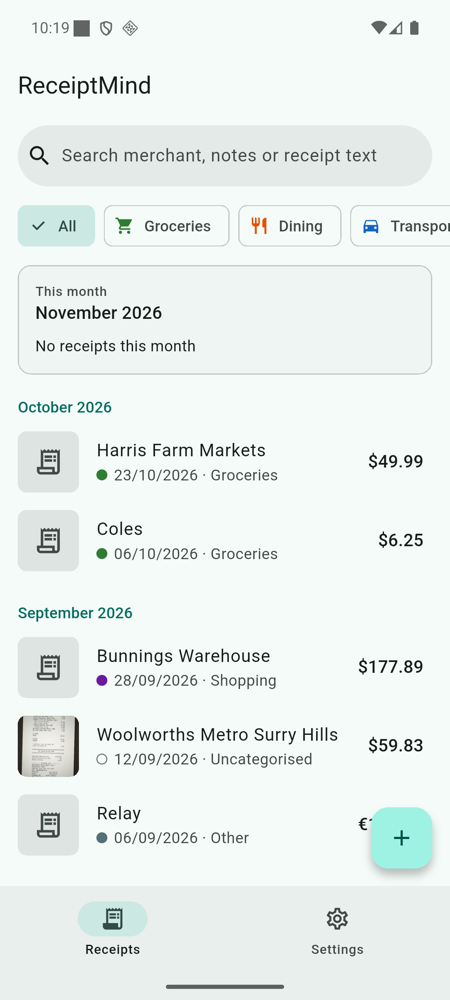
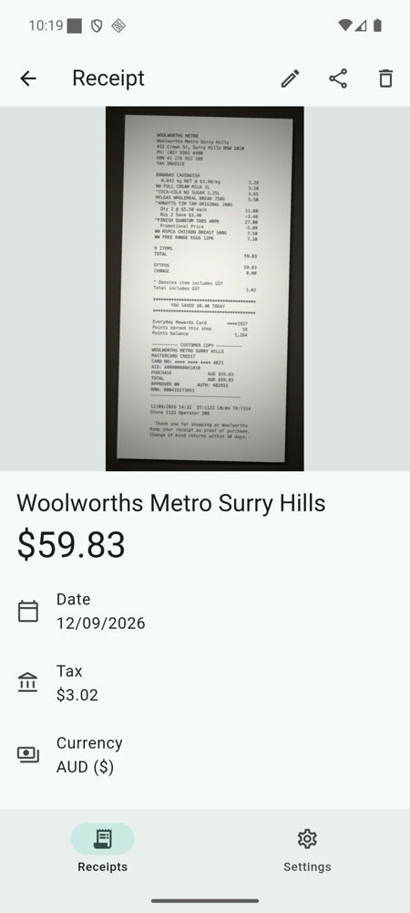
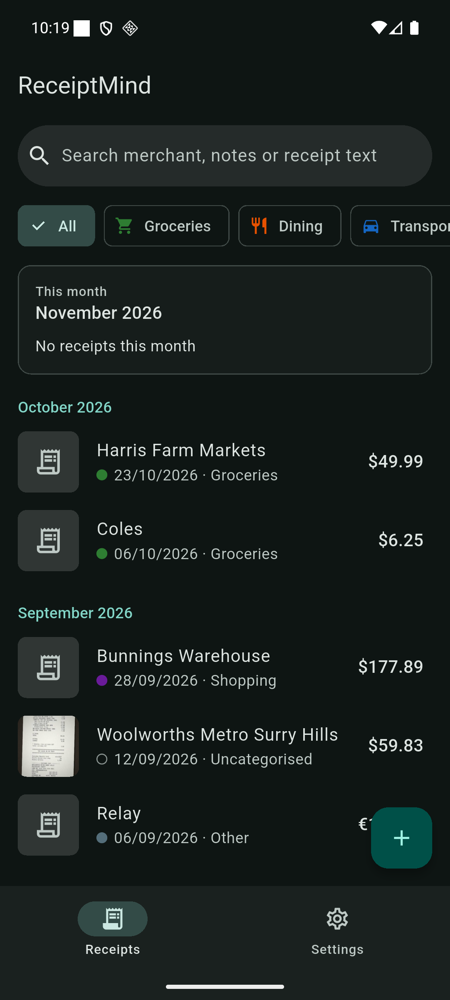
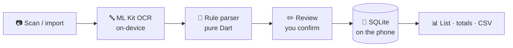

# ReceiptMind: Private Offline AI Receipt Scanner

[](LICENSE)
[](https://flutter.dev)
[](#build-from-source)
[](#privacy)

**Snap a receipt and the phone reads it.** Merchant, date, total, tax and payment method are extracted
**on the device** and saved to a private expense tracker. No account, no cloud, no ads, no tracking.
Your receipts never leave your phone.

<p align="center">
  
  
  
  
</p>

> **Status: v0.1 in active development.** Scanning, on-device OCR, parsing, review, the receipt list,
> categories, settings and CSV export work today (screenshots above are from the current build on Android).
> Hardening and the first signed APK release are next — see the [roadmap](#roadmap).

## Features

- **Scan or import** — camera scanning with automatic edge detection, or pick a photo from the gallery and crop it.
- **On-device OCR** — Google ML Kit text recognition runs entirely on the phone (Latin script).
- **Smart pre-fill** — a rule-based parser reads merchant, date, total, subtotal, tax (incl. VAT/MwSt tables),
  tip, currency and payment method, with a confidence score per field. Unsure fields are flagged ⚠️.
- **You stay in control** — every receipt is reviewed before saving; zoom into the photo, see the recognised text,
  fix anything. Manual entry works too.
- **Expense tracker** — search (merchant, notes and receipt text), category filters, month sections and
  monthly totals per currency, swipe to delete with undo.
- **Categories** — 7 defaults (Groceries, Dining, Transport, …); add your own with icons and colours.
- **Multi-currency & locale aware** — every receipt keeps its own ISO currency; amounts are exact integer minor
  units (never floating point); default currency and date format follow your region.
- **CSV export** — all receipts or a date range, Excel-friendly (UTF-8 BOM) with CSV-injection protection.
- **Light & dark theme**, large-text and screen-reader friendly.
- **Developer mode** — an OCR debug view (boxes, rows, parser trace) and *Export as fixture* so anyone can
  contribute hard receipts to improve the parser.

## Privacy

- Receipt photos, recognised text and your spending data are stored **only on your device**.
- The Android release build has **no `INTERNET` permission**, so the app cannot send anything anywhere.
  You can verify it yourself with `aapt2 dump permissions`.
- Android cloud backup is turned off, so receipts are not copied to Google Drive behind your back.
  An explicit, encrypted backup you control is planned for v0.3.
- No analytics and no crash reporting.
- Photos are re-encoded before saving, which strips EXIF metadata such as GPS location.
- Text recognition uses Google ML Kit **on-device**. ML Kit normally sends anonymous usage metrics
  (device model, app version, latency) to Google; without network permission it cannot. Receipt
  content is never part of those metrics. A fully open-source build using Tesseract is planned.

## How it works



1. The document scanner returns a cropped photo of the receipt.
2. ML Kit returns text lines with bounding boxes; the parser rebuilds the printed rows from the boxes
   (OCR engines often return the item names and the prices as separate columns).
3. The parser scores candidates for each field (keywords, position, text size, consistency such as
   *total = subtotal + tax + tip*) and a validator checks that the numbers add up.
4. You review and save. The photo is stored compressed (≤ 2400 px, no EXIF) with a thumbnail.

### Parser accuracy

Measured with `dart run tool/parser_report.dart` on the fixture set (28 receipts from Australia, the US,
the UK and Germany, including 8 scored blind as a holdout):

| Country | merchant | date | total | subtotal | tax | tip | currency | payment |
|---|---:|---:|---:|---:|---:|---:|---:|---:|
| AU | 100 % | 100 % | 100 % | 100 % | 100 % | 100 % | 100 % | 100 % |
| DE | 100 % | 100 % | 100 % | — | 100 % | — | 100 % | 100 % |
| UK | 100 % | 100 % | 100 % | 100 % | 100 % | — | 100 % | 100 % |
| US | 100 % | 100 % | 100 % | 100 % | 100 % | 100 % | 100 % | 100 % |

The fixtures are synthetic but realistic (supermarkets, restaurants with tips, fuel, pharmacies, retail),
so real-world accuracy will be lower — which is exactly why contributing real, anonymised receipts helps
([how](CONTRIBUTING.md#adding-receipt-fixtures)).

## Tech stack

| | |
|---|---|
| App | Flutter 3.47 · Dart 3.13 · Material 3 |
| State & navigation | Riverpod 3 (code generation) · go_router |
| Storage | Drift (SQLite) · files in the private app-support directory |
| OCR & scanning | Google ML Kit Text Recognition (on-device) · `cunning_document_scanner` |
| Parser | [`packages/receipt_parser`](packages/receipt_parser) — pure Dart, no Flutter imports, ~360 unit tests |
| Quality | `flutter_lints` + stricter rules · 400+ widget/unit tests · on-device integration tests |

## Project structure

```
lib/
  app/                 router, theme, start-up housekeeping
  core/                money, dates, locale defaults, database (Drift), settings, shared widgets
  features/
    scan/              document scanner, ML Kit OCR engine, scan flow controller
    receipts/          repository + image store, list, detail, review screen
    categories/        category management
    settings/          settings, About & privacy
    export/            CSV export
    developer/         OCR debug view, fixture export
packages/receipt_parser/   rule-based parser, lexicons (en, de), fixtures, accuracy report
integration_test/          on-device tests (OCR pipeline, image store, scan flow)
```

## Roadmap

| Version | Scope | Status |
|---|---|---|
| **v0.1** | Scan / import, on-device OCR, rule parser, review screen, receipt list, search, categories, monthly totals, CSV export, dark mode, developer mode | 🚧 features done, hardening + first APK release next |
| v0.2 | Optional on-device AI model, line items, auto-categorisation, charts and budgets | planned |
| v0.3 | App lock, encrypted backup, home-screen widget, batch import, share-to-app | planned |
| v1.0 | Warranty reminders, tax reports, tap a field to see where it was found on the photo | planned |

## Build from source

Requirements: Flutter 3.47+ (Dart 3.13+), Android SDK 36, and Xcode 16+ for iOS.

```bash
flutter pub get
flutter run
```

Run the checks:

```bash
flutter analyze
flutter test
(cd packages/receipt_parser && dart test && dart run tool/parser_report.dart --check)
```

Generated code (`*.g.dart`, localizations) is committed, so you only need `build_runner` when you change
annotated code. See [CONTRIBUTING.md](CONTRIBUTING.md).

## Contributing

Contributions are welcome. **Adding receipts from your country** is the easiest way to help, and it
needs no Flutter knowledge. Adding a language to the parser is just a keyword list. Start with
[CONTRIBUTING.md](CONTRIBUTING.md).

## License

[Apache License 2.0](LICENSE) © 2026 Muhammad Nauman. See [NOTICE](NOTICE) for third-party terms.
